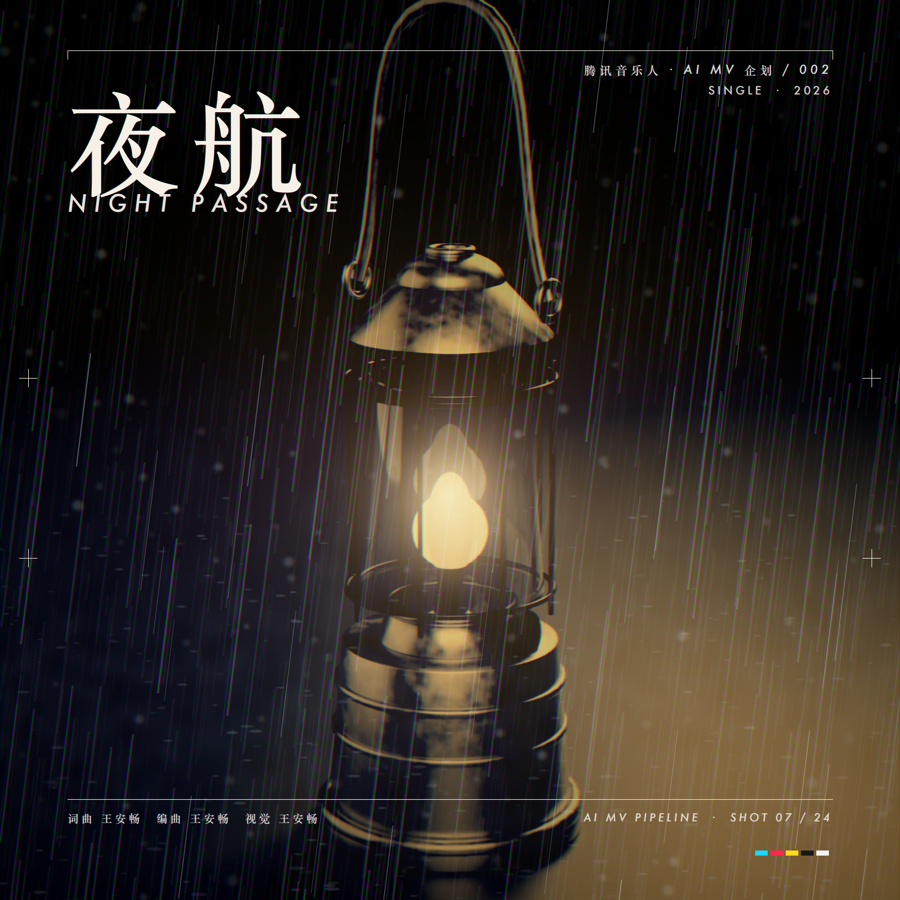
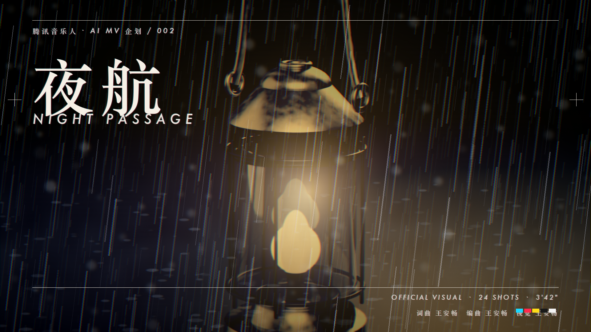
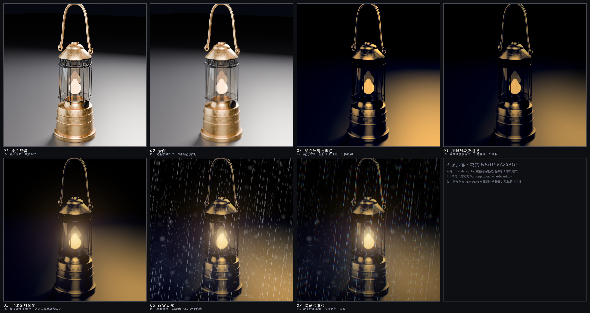
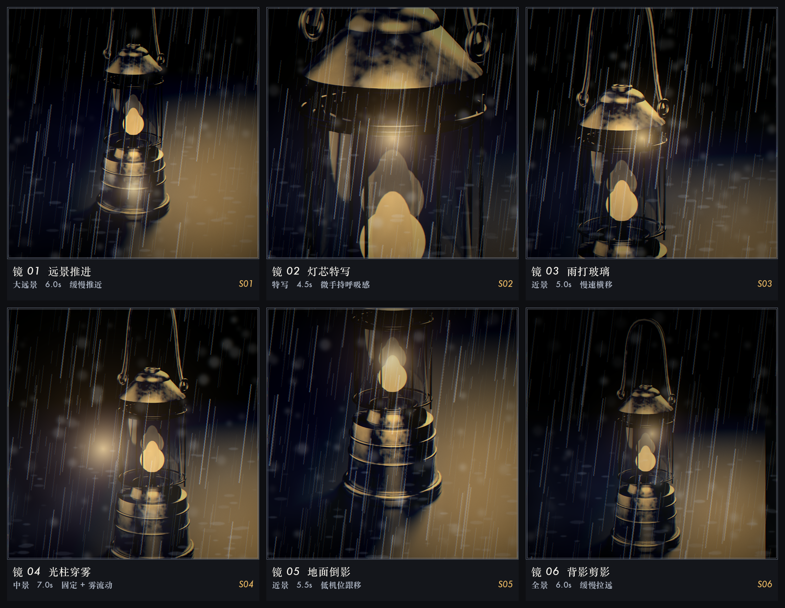

# 夜航 · AI MV 视觉物料与自动化流程

单曲《夜航 / NIGHT PASSAGE》的整套视觉物料：专辑封面、MV 主视觉、竖版短视频封面、分镜表，
以及把「分镜 → prompt → 出片 → 发布」串起来的批量脚本。

做这套东西的出发点是一个很具体的问题：**AI 视频流程里真正花时间的不是点「生成」，而是生成之前的规划和生成之后的整理。**
所以这里既有成品图，也有让成品图能批量复现的那套脚本。

| 专辑封面 3000×3000 | MV 主视觉 1920×1080 | 竖版封面 1200×2133 |
| --- | --- | --- |
|  |  |  |

---

## 一、物料清单

| 文件 | 尺寸 | 用途 |
| --- | --- | --- |
| [`out/01_专辑封面_3000x3000.png`](out/01_专辑封面_3000x3000.png) | 3000×3000 | 专辑封面 / 播放器大图 |
| [`out/02_MV主视觉_1920x1080.png`](out/02_MV主视觉_1920x1080.png) | 1920×1080 | MV 主视觉、视频封面 |
| [`out/03_竖版短视频封面_1200x2133.png`](out/03_竖版短视频封面_1200x2133.png) | 1200×2133 | 竖版短视频封面 |
| [`out/04_图层拆解_7阶段.png`](out/04_图层拆解_7阶段.png) | 4530×2402 | 合成过程拆解（7 个阶段） |
| [`out/05_AI分镜表_6镜.png`](out/05_AI分镜表_6镜.png) | 2240×1736 | 6 镜关键帧分镜表 |
| [`ai-pipeline/shot_blueprint.json`](ai-pipeline/shot_blueprint.json) | — | 分镜蓝图：每镜画面 / 运镜 / prompt / seed |
| [`ai-pipeline/prompts/`](ai-pipeline/prompts) | — | 展开后的批量 prompt 包（表格 + 每镜一份 + 重命名表） |

---

## 二、合成拆解

主视觉不是「一键生成」，是 7 层搭出来的。每一层都能在 Photoshop 里找到对应操作，
脚本里的函数名也是按 PS 的叫法起的：

| # | 阶段 | 脚本里对应 | PS 里对应 |
| --- | --- | --- | --- |
| 1 | 原片裁切 | `core.fit_cover()` | 置入原片、裁切构图 |
| 2 | 景深 | 高斯模糊 + 渐变蒙版合成 | 模糊图层 + 黑白渐变蒙版 |
| 3 | 渐变映射与调色 | `duotone()` `curve()` `split_tone()` | 渐变映射 + 色阶 + 分离色调 |
| 4 | 压暗与蒙版渐变 | `linear_ramp()` `radial()` | 线性/径向渐变填充层，正片叠底 |
| 5 | 主体光与辉光 | `glow()` `bloom()` `halation()` | 径向渐变 + 滤色；高光选区模糊做辉光 |
| 6 | 雨雾天气 | `rain()` `fog()` `bokeh()` `splashes()` | 笔刷雨丝 + 云雾滤镜 + 近景虚焦 |
| 7 | 暗角与颗粒 | `vignette()` `chroma_shift()` `grain()` | 镜头校正暗角 + 添加杂色（柔光） |



### 关于工具链（说明一下，避免误读）

这套物料是用 **Python + Pillow + numpy 写代码合成**的，不是用 Photoshop 界面做的，也不是 AI 一键生图。
原因是这一批图要作为**模板批量复用**：改成方形/横版/竖版三种尺寸、换成别的歌，都只需要改参数重跑，
不用回 PS 里重新对图层。上表中「PS 里对应」那一列是给不写代码的协作用的对照——
同样的效果在 PS 里就是那几步操作。

所以这份作品想证明的是两件事：**画面合成的判断力**（怎么分层、怎么调色、光怎么走），
以及**把重复劳动写成流程的能力**（这部分正是 MV 批量生产要解决的问题）。

**底图来源**：黄铜提灯是自己在 Blender 里建模渲染的静物（[brass-lantern](https://github.com/0718lol/brass-lantern)，
程序化建模 + 展 UV + 程序化材质 + Cycles 渲染），不是素材网站下的图，整条链路可查。
影棚灰底在这里被当作「夜里的雾」重新调色使用。

### 两个合成细节

**混排字体**：中文大字走宋体、西文小字走无衬线，两套字体在同一行里按字符边界切换，
否则西文字体拿不到汉字字形，会直接掉成方框（`core.py::_draw_mixed`）。

**套印不准**：文字层额外叠一层偏青、一层偏品红的错位副本，滤色混合。
这是印刷打样的错版效果，用来让纯数字产物有点实体感（`render_artboards.py::cmyk_misregistration`）。

---

## 三、AI MV 分镜与批量流程

6 镜关键帧同框在一张分镜表上，每镜标注景别 / 时长 / 运镜 / 对应 prompt 编号：



分镜蓝图是机器可读的（[`ai-pipeline/shot_blueprint.json`](ai-pipeline/shot_blueprint.json)），
用一条命令展开成可以批量喂给生成工具的 prompt 包：

```bash
python3 ai-pipeline/build_prompts.py
```

产出：

```
ai-pipeline/prompts/
├── queue.csv        每镜一行：关键帧 prompt / 图生视频 prompt / 负面提示 / seed / 期望文件名
├── S01.txt … S06.txt  每镜一份，可直接复制
└── rename_map.txt   生成文件 → 目标命名，出片后照着重命名
```

### 为什么要有这套东西

手工做 MV 的时候，三个环节最容易出错：

1. **prompt 对不上镜号** —— 生成了一堆图，忘了哪张是哪一镜。这里每镜带固定 seed 和镜头描述，可复现、可回滚。
2. **素材命名混乱** —— 出片后按 `01_S01_远景推进.mp4` 重命名，剪辑软件按文件名排序，时间线自动就对了。
3. **改一版要重做一遍** —— 分镜蓝图是数据，改 JSON 重新展开即可，不用手改十几个 prompt。

不依赖任何具体模型：`queue.csv` 可以直接导进批处理工具，`S0x.txt` 手动粘到网页端也行。

### 完整流程

```
音乐分析(BPM/段落/情绪) → 分镜蓝图(JSON) → 批量 prompt(本仓库脚本)
      → 生图出关键帧 → 图生视频 → 剪辑调色 → 三尺寸出片 → 平台发布
```

---

## 四、跑一遍

只依赖 Python + Pillow + numpy，没有其他美术依赖：

```bash
# 三张版面
python3 scripts/render_artboards.py          # 全部
python3 scripts/render_artboards.py 01       # 只出某一张（按前缀）

# 图层拆解图
python3 scripts/make_breakdown.py

# 分镜表
python3 scripts/make_storyboard.py

# prompt 包
python3 ai-pipeline/build_prompts.py
```

底图默认读同级目录下的 `../3d-portfolio/04_render/01_hero.png`，
换自己的素材改 [`scripts/render_artboards.py`](scripts/render_artboards.py) 顶部的 `SRC` 即可。

### 目录结构

```
mv-visual-lab/
├── out/                  成品：三张版面 + 拆解图 + 分镜表
├── scripts/
│   ├── core.py           合成积木：渐变映射/辉光/雨雾/颗粒/套印错位…
│   ├── render_artboards.py  三张版面
│   ├── make_breakdown.py    图层拆解图
│   └── make_storyboard.py   分镜表
└── ai-pipeline/
    ├── shot_blueprint.json  分镜蓝图
    ├── build_prompts.py     展开成批量 prompt
    └── prompts/             展开结果
```

### 环境

- Python 3.12 + Pillow 12 + numpy 2（无其他依赖）
- 字体走 macOS 系统字体（宋体 / Didot / Futura），非 macOS 需要改 `core.py::fonts()` 里的字体路径
- 单张 3000×3000 出图约 9 秒
